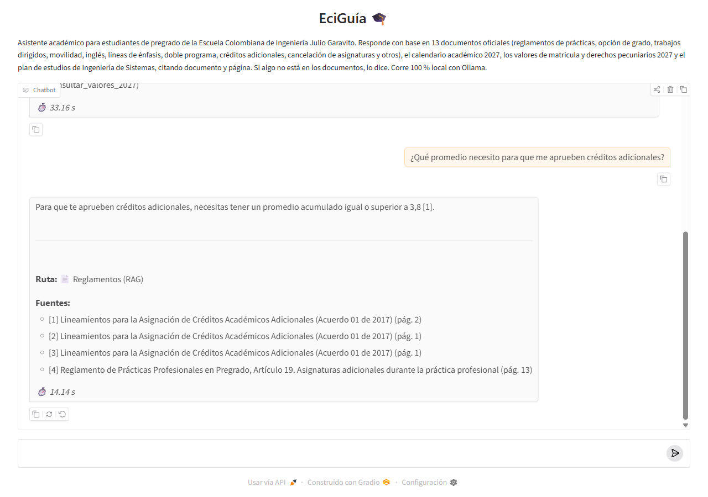
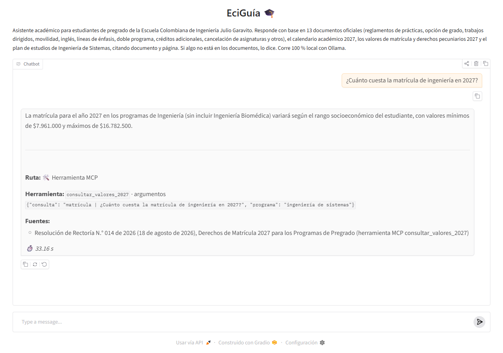

# EciGuía

Asistente académico para estudiantes de pregrado de la Escuela Colombiana de Ingeniería Julio Garavito. Responde dudas sobre prácticas profesionales y práctica docente, opción de grado, trabajos dirigidos, movilidad, inglés, doble programa, créditos adicionales, cancelación de asignaturas, líneas de énfasis y representación estudiantil (13 documentos oficiales), además del calendario académico 2027, los valores de matrícula y derechos pecuniarios 2027 y el plan de estudios de Ingeniería de Sistemas. Cita el documento y la página de donde sale cada dato. Si algo no está en los documentos, lo dice. Todo corre en local con Ollama, gratis y sin enviar datos a terceros.

Proyecto final de GELM (IA Generativa), 2026-2, de Marlio José Charry Espitia.

- **Informe:** [`proyecto.ipynb`](proyecto.ipynb). Se puede leer en GitHub con todas las salidas, o ejecutar con *Restart & Run All*, también sin Ollama.
- **Video:** *(enlace pendiente)*

| Pregunta sobre reglamentos (RAG con citas) | Pregunta que usa una herramienta MCP |
| --- | --- |
|  |  |

Debajo de cada respuesta la app muestra por qué ruta pasó la pregunta, qué herramienta usó, de qué documento y página sale cada dato y cuánto tardó.

## Cómo funciona

```
pregunta ─▶ router (LLM) ─┬─▶ documentos ─▶ Chroma (top 4, umbral 0,45) ─┬─▶ respuesta con citas [1] [2]
                          │                                              └─▶ "no encontré esa información"
                          ├─▶ herramienta ─▶ servidor MCP (FastMCP, stdio) ─▶ respuesta
                          │                  · consultar_calendario
                          │                  · dias_hasta
                          │                  · calcular_promedio_ponderado
                          │                  · consultar_valores_2027   (matrícula y derechos pecuniarios)
                          │                  · consultar_plan_estudios  (Ingeniería de Sistemas)
                          └─▶ fuera de alcance ─▶ rechazo amable
```

| Parte | Tecnología | Archivo |
| --- | --- | --- |
| Carga y chunking por artículo | pdfplumber + LangChain text splitters | `src/eciguia/ingest.py` |
| Embeddings y búsqueda | `bge-m3` en Ollama + Chroma | `src/eciguia/retriever.py` |
| Agente con router | LangGraph | `src/eciguia/graph.py` |
| Herramientas | FastMCP | `src/eciguia/mcp_server.py`, `tools_logic.py` |
| Prompts versionados | | `src/eciguia/prompts.py` |
| Interfaz | Gradio | `app.py` |
| Evaluación | 40 preguntas + LLM como juez | `eval/` |

## Resultados

### Segunda etapa: corpus ampliado (configuración actual de la app)

El corpus pasó de 6 a 13 documentos y se agregaron dos herramientas. Se evaluó con el set original como prueba de regresión y con un set nuevo de 26 preguntas:

| Set | Recuperación | Ruteo | Herramienta | Rechazo | Revisión humana |
| --- | --- | --- | --- | --- | --- |
| Original, 40 preguntas (`8_final_original`) | 100 % | 100 % | 100 % | 100 % | 33/33 correctas, **0 regresiones** frente a `6_final` |
| Ampliación, 26 preguntas (`8_final_nuevas`) | 100 % | 100 % | 100 % | 100 % | 22/22 correctas, 4/4 trampas rechazadas |

- **Router en un set aparte** de 32 preguntas que no se usaron para escribir los prompts: V1 81 %, V2 84 %, **V3 97 %**.
- **El umbral de relevancia se mantuvo en 0,45** al recalibrar con el corpus ampliado (39 positivas y 31 negativas).
- Los fallos de la primera corrida de la ampliación (argumentos faltantes, citas inventadas, la trampa de Ingeniería Civil) se corrigieron en el código, con pruebas unitarias. Detalle en la sección 4.7 del notebook.

### Primera etapa: 6 corridas sobre el corpus inicial

Evaluación con 40 preguntas de respuesta conocida, en 6 corridas que cambian una cosa a la vez (detalle y discusión en la sección 4 del notebook):

| Corrida | Qué cambia | Recuperación | Ruteo | Rechazo | Acierto reglamentos | Acierto fechas/cálculos | Latencia |
| --- | --- | --- | --- | --- | --- | --- | --- |
| `1_base` | RAG sin router, prompt básico, chunking fijo | 96 % | 68 % | 86 % | 100 % | 25 % | 13,8 s |
| `2_chunk_articulo` | chunking por artículo | 100 % | 68 % | 100 % | 96 % | 12 % | 12,2 s |
| `3_router_tools` | + router y herramientas MCP | 100 % | 92 % | 100 % | 84 % | 100 % | 14,1 s |
| `4_prompt_v1` | prompt RAG con reglas | 100 % | 92 % | 100 % | 80 % | 100 % | 12,1 s |
| `5_prompt_v2` | prompt RAG V2 | 100 % | 92 % | 100 % | 84 % | 100 % | 12,5 s |
| `6_final` | router V2 + prompt RAG V3 (la app) | 100 % | 98 % | 100 % | 92 % | 100 % | 12,2 s |

- **Revisión humana de la corrida final:** 32 de 33 respuestas correctas y 7 de 7 rechazos correctos. El juez LLM coincidió con la revisión manual en 8 de 10 casos y fue más permisivo cuando falló.
- **Umbral de relevancia calibrado** (`eval/calibrate.py`): con 0,45 pasan todas las preguntas con respuesta y se bloquea el 81 % de las que no la tienen; con el valor inicial de 0,65 solo se bloqueaba el 7 %. Ver `docs/resultados/calibracion.png`.
- **Fallos analizados:** sesgo del router con las preguntas de matrícula, abstenciones por una regla demasiado estricta y polaridad de sí/no y aritmética de fechas del modelo de 7B. La regresión del router V2 ("¿Quiénes forman el jurado…?") se corrigió en V3.

Todos los resúmenes, la tabla comparativa y la validación del juez están en [`docs/resultados/`](docs/resultados/).

## Instalación

Requisitos: [uv](https://docs.astral.sh/uv/) y [Ollama](https://ollama.com). Probado en Windows 11 con una GPU de 6 GB (RTX 3050).

```powershell
# uv en Windows (si no lo tienes)
powershell -ExecutionPolicy ByPass -c "irm https://astral.sh/uv/install.ps1 | iex"

ollama pull qwen2.5:7b      # modelo que responde
ollama pull bge-m3          # embeddings multilingües
uv sync                     # instala dependencias (incluye las del notebook)
copy .env.example .env      # opcional, para cambiar modelos o parámetros
```

En PowerShell conviene activar UTF-8 para ver bien las tildes: `$env:PYTHONUTF8=1`.

## Uso

```powershell
uv run python -m eciguia.ingest                    # 1. construye el índice (una sola vez, ~1 min)
uv run python app.py                               # 2. abre la app en http://localhost:7860
uv run python -m eciguia.graph "¿Cuánto dura la práctica?"   # o pregunta desde la terminal
```

El servidor MCP también se puede usar solo, con cualquier cliente MCP: `uv run python -m eciguia.mcp_server`.

## Evaluación

Hay dos sets de preguntas con respuesta conocida:
- `eval/golden_set.jsonl` (40): 25 de reglamentos (con documento y artículo esperados), 8 de herramientas y 7 fuera de alcance o trampa.
- `eval/golden_set_ampliacion.jsonl` (26): preguntas sobre los documentos y herramientas de la segunda etapa.

```powershell
uv run python -m eciguia.ingest --strategy fijo     # índice alterno para comparar chunking
uv run python eval/calibrate.py                     # calibra el umbral de relevancia
uv run python eval/run_eval.py --name 1_base --baseline --prompt basico --strategy fijo
uv run python eval/run_eval.py --name 2_chunk_articulo --baseline --prompt basico
uv run python eval/run_eval.py --name 3_router_tools --prompt basico
uv run python eval/run_eval.py --name 4_prompt_v1 --prompt v1
uv run python eval/run_eval.py --name 5_prompt_v2 --prompt v2
uv run python eval/run_eval.py --name 6_final --router v2 --prompt v3
# segunda etapa (configuración actual): regresión sobre el set original y set de ampliación
uv run python eval/run_eval.py --name 8_final_original --golden original
uv run python eval/run_eval.py --name 8_final_nuevas --golden ampliacion
uv run python eval/regresion.py 6_final 8_final_original   # qué empeoró y qué mejoró, pregunta por pregunta
uv run python eval/compare_router.py                # versiones del router en 32 preguntas que no se usaron para escribirlas
```

Cada experimento cambia una sola cosa respecto al anterior. Métricas: hit@4 del retriever, ruteo correcto, herramienta correcta, rechazo correcto, acierto y fidelidad (LLM como juez, validado a mano) y latencia mediana. El detalle queda en `eval/results/` y los resúmenes finales en `docs/resultados/`.

## Estructura del repositorio

```
├── app.py                     # interfaz web (Gradio)
├── proyecto.ipynb             # informe de entrega (notebook)
├── src/eciguia/
│   ├── config.py              # parámetros (modelos, umbral, rutas), editables con .env
│   ├── ingest.py              # extracción de PDF y transcripciones, chunking e índice Chroma
│   ├── retriever.py           # búsqueda con umbral de relevancia y formato de citas
│   ├── graph.py               # agente LangGraph: router, RAG, herramientas, rechazo
│   ├── prompts.py             # prompts versionados (ROUTER_V1..V3, RAG_ANSWER_BASICO..V3)
│   ├── mcp_server.py          # servidor MCP (FastMCP) con 5 herramientas
│   └── tools_logic.py         # lógica de las herramientas (calendario, promedio, valores, plan)
├── data/
│   ├── raw/                   # PDF oficiales que se indexan
│   ├── transcripciones/       # transcripción de los PDF escaneados
│   ├── fuentes_tabulares/     # PDF de tablas (matrícula, derechos, planes)
│   ├── calendario_2027.json, valores_2027.json, plan_estudios_sistemas.json
├── eval/                      # sets de preguntas, evaluación, calibración, regresión, ruteo
├── docs/
│   ├── resultados/            # resúmenes de todas las corridas, gráficas y validaciones
│   ├── img/                   # capturas de la app
│   └── guion_video.md
├── tests/                     # pruebas sin Ollama (uv run pytest)
└── PLAN.md                    # plan de trabajo y decisiones del proyecto
```

## Problemas frecuentes

- **La app se queda "cargando" o responde con un error de tiempo agotado.** En GPUs de 6 GB, Ollama a veces se traba después de cargas pesadas, por ejemplo justo después de reconstruir el índice. Reinicia Ollama (ciérralo desde la bandeja del sistema y ábrelo de nuevo) y vuelve a preguntar. Cada llamada tiene un límite de 180 s (`ECIGUIA_OLLAMA_TIMEOUT`), así que la app avisa en vez de quedarse esperando.
- **La primera pregunta tarda mucho más que las siguientes.** Es la carga inicial de los modelos y del servidor MCP. Haz una pregunta de calentamiento antes de una demo.
- **Tildes raras en la terminal de Windows.** Ejecuta `$env:PYTHONUTF8=1` en PowerShell antes de los comandos.
- **"El índice está vacío".** Falta construirlo: `uv run python -m eciguia.ingest`.

## Pruebas

```powershell
uv run pytest      # no necesitan Ollama (usan embeddings y LLM simulados)
```

## Documentos usados

Todos son documentos oficiales de [escuelaing.edu.co](https://www.escuelaing.edu.co/es/estudiantes/reglamentos-y-cronogramas-academicos/).

| Carpeta | Contenido | Cómo se usa |
| --- | --- | --- |
| `data/raw/` | Reglamentos de Prácticas Profesionales (2026), Trabajos Dirigidos (2026), Movilidad (2026), Inglés (2025), Líneas de Énfasis; Lineamientos de Opción de Grado y de Práctica Docente (2023); Modificación al Reglamento Estudiantil (2025); Condiciones del Doble Programa (Acta 382 de 2026); y 3 PDF escaneados | RAG |
| `data/transcripciones/` | Transcripción de los escaneados: créditos adicionales, cancelación de asignaturas y régimen de participación estudiantil (Acuerdos 70 y 71 de 2017) | RAG (reemplaza al PDF) |
| `data/calendario_2027.json` | Calendario académico 2027 (transcrito de una imagen) | Herramienta MCP |
| `data/valores_2027.json` | Matrícula 2027 (Res. 014 de 2026) y derechos pecuniarios 2027 (Res. 016 de 2026); los PDF están en `data/fuentes_tabulares/` | Herramienta MCP |
| `data/plan_estudios_sistemas.json` | Planes de estudio de Ingeniería de Sistemas (antes y desde 2025-1); los PDF están en `data/fuentes_tabulares/` | Herramienta MCP |

Las transcripciones y los JSON se hicieron a mano y se verificaron contra los PDF originales.

## Limitaciones conocidas

- No incluye el Reglamento Estudiantil de Pregrado completo, solo su modificación de 2025. La versión de 2018 se descartó a propósito porque trae artículos que esa modificación derogó. Por eso no responde preguntas de asistencia, notas mínimas o pérdida de cupo; las reconoce como fuera de sus documentos.
- El plan de estudios cubre solo Ingeniería de Sistemas y no incluye prerrequisitos.
- Los Lineamientos de Opción de Grado piden el 80 % de los créditos y el Reglamento de Prácticas (2026) pide el 75 %. El asistente debe mostrar ambos.
- El calendario se transcribió a mano: ante cualquier duda, manda el calendario oficial.
- El juez de la evaluación es el mismo modelo que responde, lo que puede inflar las métricas. Por eso se validó a mano una muestra de sus veredictos.
