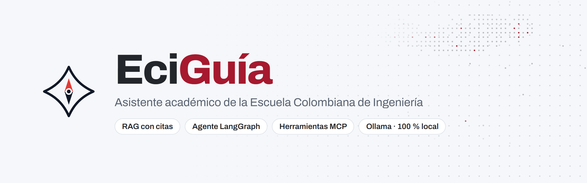
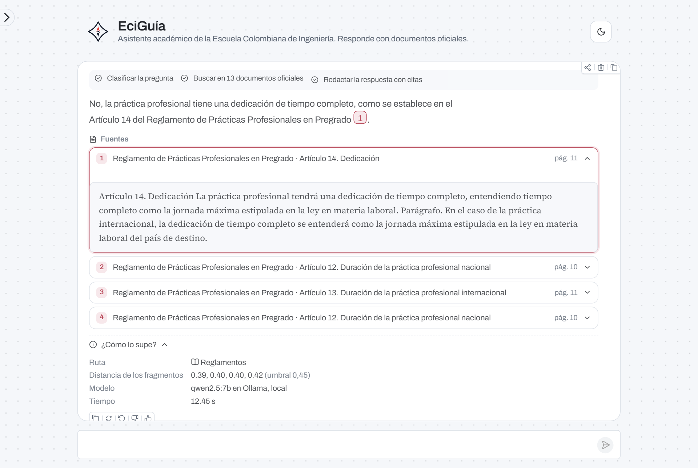
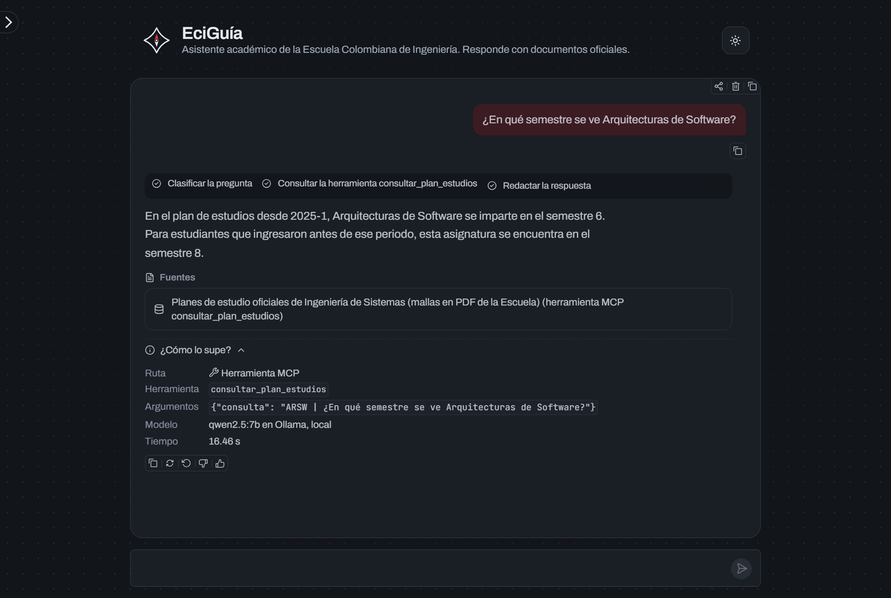
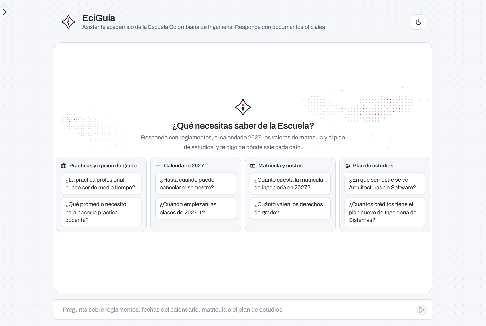
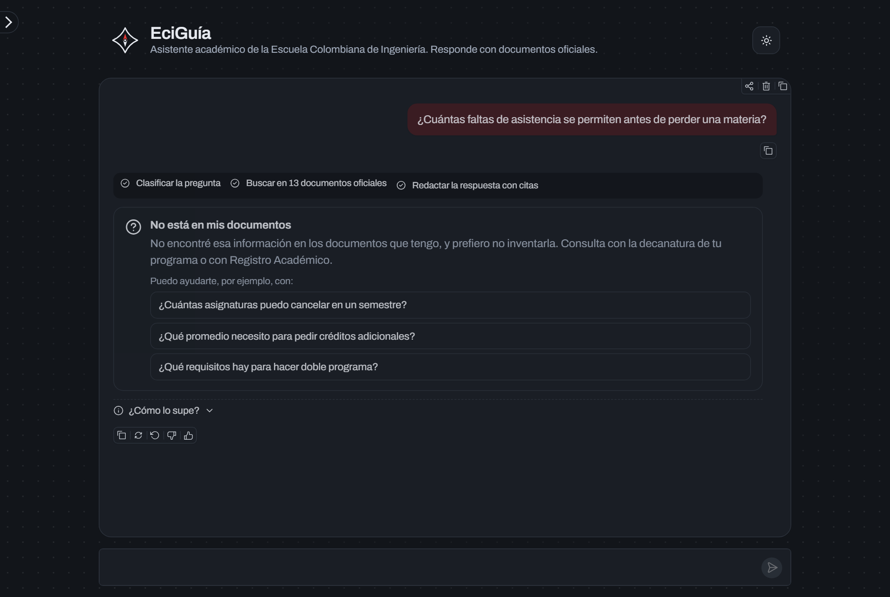
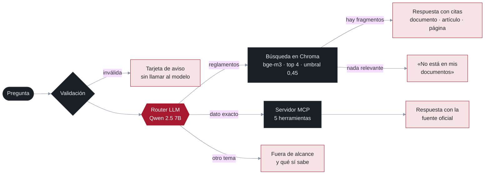

<p align="center">
  <picture>
    <source media="(prefers-color-scheme: dark)" srcset="docs/img/banner-oscuro.png">
    
  </picture>
</p>

<p align="center">
  
  
  
  
  
  
</p>

<p align="center">
  <a href="https://pruebacorreoescuelaingeduco-my.sharepoint.com/:v:/g/personal/marlio_charry-e_mail_escuelaing_edu_co/IQDksiJtIJ0HTbxWtPXo79w8ASer20ylCExb8rXgUP-j6fA?e=ZUmnGx"><b>Ver el video (4:05)</b></a>
  &nbsp;·&nbsp; <a href="proyecto.ipynb"><b>Informe (notebook)</b></a>
  &nbsp;·&nbsp; <a href="#resultados"><b>Resultados</b></a>
  &nbsp;·&nbsp; <a href="#instalación"><b>Instalación</b></a>
</p>

---

EciGuía responde las dudas académicas de los estudiantes de pregrado de la **Escuela Colombiana de Ingeniería Julio Garavito** con los documentos oficiales: reglamentos, acuerdos, el calendario 2027, los valores de matrícula 2027 y el plan de estudios de Ingeniería de Sistemas. **Cita el documento y la página** de cada dato, y cuando algo no está en sus documentos **lo dice en vez de inventarlo**. Todo corre en un portátil con Ollama, gratis y sin enviar datos a terceros.

> Proyecto final de **IA Generativa (GELM) 2026-2** · Marlio José Charry Espitia

| <h3>13</h3>documentos oficiales indexados | <h3>55/55</h3>respuestas correctas en revisión manual | <h3>12/12</h3>trampas rechazadas sin inventar | <h3>97 %</h3>de acierto del router en preguntas nuevas | <h3>0</h3>regresiones al ampliar el corpus |
| :---: | :---: | :---: | :---: | :---: |

## La app

| Reglamentos: RAG con citas que se abren | Herramienta MCP, en modo oscuro |
| --- | --- |
|  |  |
| **Pantalla de inicio** con preguntas de ejemplo por categoría | **Cuando no lo sabe**, lo dice y sugiere qué sí puede responder |
|  |  |

- **Proceso en vivo.** Mientras el modelo trabaja se ve cada paso (clasificar, buscar o consultar la herramienta, redactar) y luego el texto se escribe en tiempo real.
- **Citas verificables.** Cada `[1]` es un botón: abre la fuente con el texto original del artículo.
- **"¿Cómo lo supe?"** muestra la ruta, la herramienta y sus argumentos, la distancia de cada fragmento frente al umbral, el modelo y el tiempo.
- **Robusta.** Valida la entrada antes del modelo (vacía, demasiado larga, sin texto o intento de cambiar sus instrucciones). Si Ollama falla o tarda más de 180 s, muestra una tarjeta de error que dice cómo arreglarlo en vez de quedarse cargando.
- **Panel "Qué sé"** con los 13 documentos y lo que no sabe, **modo claro y oscuro** que se recuerda, y valoración de cada respuesta (útil / no útil) guardada en local.

## Cómo funciona



El agente es un grafo de **LangGraph**. El **router** (un LLM con prompt versionado) decide entre tres rutas:

1. **Reglamentos (RAG).** Los PDF se cortan por artículo, se embeben con `bge-m3` y se guardan en Chroma. Solo pasan los fragmentos con distancia menor que **0,45**, un umbral calibrado con datos. El prompt obliga a citar `[n]` y a decir "no encontré" si la respuesta no está, y las citas fuera de rango se eliminan.
2. **Herramientas (MCP).** Lo que exige un dato exacto va a un servidor **FastMCP** por stdio: `consultar_calendario`, `dias_hasta`, `calcular_promedio_ponderado`, `consultar_valores_2027` y `consultar_plan_estudios`. El agente lista las herramientas del servidor y el LLM elige una con sus argumentos.
3. **Fuera de alcance.** Responde con amabilidad qué temas sí cubre.

| Parte | Tecnología | Archivo |
| --- | --- | --- |
| Ingesta y chunking por artículo | pdfplumber + LangChain text splitters | `src/eciguia/ingest.py` |
| Embeddings y búsqueda con umbral | `bge-m3` en Ollama + Chroma | `src/eciguia/retriever.py` |
| Agente con router y streaming | LangGraph | `src/eciguia/graph.py` |
| Herramientas | FastMCP | `src/eciguia/mcp_server.py`, `tools_logic.py` |
| Prompts versionados | ROUTER V1–V3, RAG básico y V1–V3 | `src/eciguia/prompts.py` |
| Validación de entradas | reglas, sin LLM | `src/eciguia/validation.py` |
| Interfaz | Gradio con tema, CSS y JS propios | `app.py`, `src/eciguia/ui.py`, `assets/` |
| Evaluación | 66 preguntas + LLM como juez validado a mano | `eval/` |

## Resultados

Cada experimento cambia **una sola cosa** respecto al anterior y se mide con preguntas de respuesta conocida. El detalle, las gráficas y la discusión están en la sección 4 del [notebook](proyecto.ipynb) y en [`docs/resultados/`](docs/resultados/).

### De la primera versión a la final (set original de 40 preguntas)

| Métrica | Línea base (`1_base`) | Final, etapa 1 (`6_final`) | Final, etapa 2 (`8_final_original`) |
| --- | :---: | :---: | :---: |
| Recuperación (hit@4) | 96 % | 100 % | **100 %** |
| Ruteo correcto | 68 % | 98 % | **100 %** |
| Herramienta correcta | 0 % | 100 % | **100 %** |
| Rechazo correcto | 86 % | 100 % | **100 %** |
| Respuesta correcta (juez) | 82 % | 94 % | **100 %** |
| Latencia mediana | 13,8 s | 12,2 s | 12,5 s |

### Segunda etapa: el corpus pasó de 6 a 13 documentos

| Set | Recuperación | Ruteo | Herramienta | Rechazo | Revisión manual |
| --- | :---: | :---: | :---: | :---: | --- |
| Original, 40 preguntas | 100 % | 100 % | 100 % | 100 % | 33/33 correctas, **0 regresiones** frente a `6_final` |
| Ampliación, 26 preguntas | 100 % | 100 % | 100 % | 100 % | 22/22 correctas, 4/4 trampas rechazadas |

- **Router en un set aparte** de 32 preguntas que no se usaron para escribir los prompts: V1 81 %, V2 84 %, **V3 97 %**.
- **Umbral de relevancia calibrado** (`eval/calibrate.py`): con 0,45 pasan todas las preguntas con respuesta y se bloquea el 81 % de las que no la tienen. Con el valor inicial de 0,65 solo se bloqueaba el 7 % ([gráfica](docs/resultados/calibracion.png)).
- **Juez validado:** el juez es el mismo modelo que responde, así que se revisó a mano una muestra. Coincidió en 8 de 10 casos y fue más permisivo cuando falló.

<details>
<summary><b>Las 6 corridas de la primera etapa</b></summary>

| Corrida | Qué cambia | Recuperación | Ruteo | Rechazo | Acierto reglamentos | Acierto fechas/cálculos | Latencia |
| --- | --- | :---: | :---: | :---: | :---: | :---: | :---: |
| `1_base` | RAG sin router, prompt básico, chunking fijo | 96 % | 68 % | 86 % | 100 % | 25 % | 13,8 s |
| `2_chunk_articulo` | chunking por artículo | 100 % | 68 % | 100 % | 96 % | 12 % | 12,2 s |
| `3_router_tools` | + router y herramientas MCP | 100 % | 92 % | 100 % | 84 % | 100 % | 14,1 s |
| `4_prompt_v1` | prompt RAG con reglas | 100 % | 92 % | 100 % | 80 % | 100 % | 12,1 s |
| `5_prompt_v2` | prompt RAG V2 | 100 % | 92 % | 100 % | 84 % | 100 % | 12,5 s |
| `6_final` | router V2 + prompt RAG V3 | 100 % | 98 % | 100 % | 92 % | 100 % | 12,2 s |

Fallos analizados en el notebook: el sesgo del router con las preguntas de matrícula, las abstenciones por una regla demasiado estricta, y la polaridad de sí/no y la aritmética de fechas del modelo de 7B.

</details>

## Instalación

Requisitos: [uv](https://docs.astral.sh/uv/) y [Ollama](https://ollama.com). Probado en Windows 11 con una GPU de 6 GB (RTX 3050).

```powershell
# uv en Windows (si no lo tienes)
powershell -ExecutionPolicy ByPass -c "irm https://astral.sh/uv/install.ps1 | iex"

git clone https://github.com/MarlioCharryECI/eciguia-gelm.git
cd eciguia-gelm
ollama pull qwen2.5:7b      # modelo que responde
ollama pull bge-m3          # embeddings multilingües
uv sync                     # dependencias (incluye las del notebook)
copy .env.example .env      # opcional: modelos, umbral, tiempos
```

En PowerShell conviene activar UTF-8 para ver bien las tildes: `$env:PYTHONUTF8=1`.

## Uso

```powershell
uv run python -m eciguia.ingest                              # 1. construye el índice (una vez, ~1 min)
uv run python app.py                                         # 2. abre la app en http://localhost:7860
uv run python -m eciguia.graph "¿Cuánto dura la práctica?"   #    o pregunta desde la terminal
uv run python -m eciguia.mcp_server                          #    el servidor MCP solo, para cualquier cliente MCP
uv run pytest                                                # 29 pruebas, sin Ollama (LLM y embeddings simulados)
```

El notebook [`proyecto.ipynb`](proyecto.ipynb) se puede leer en GitHub con todas sus salidas, o ejecutar con *Restart & Run All*, también sin Ollama.

<details>
<summary><b>Reproducir la evaluación</b></summary>

Hay dos sets de preguntas con respuesta conocida:
- `eval/golden_set.jsonl` (40): 25 de reglamentos (con documento y artículo esperados), 8 de herramientas y 7 fuera de alcance o trampa.
- `eval/golden_set_ampliacion.jsonl` (26): preguntas sobre los documentos y herramientas de la segunda etapa.

```powershell
uv run python -m eciguia.ingest --strategy fijo     # índice alterno para comparar chunking
uv run python eval/calibrate.py                     # calibra el umbral de relevancia
uv run python eval/run_eval.py --name 1_base --baseline --prompt basico --strategy fijo
uv run python eval/run_eval.py --name 2_chunk_articulo --baseline --prompt basico
uv run python eval/run_eval.py --name 3_router_tools --prompt basico
uv run python eval/run_eval.py --name 4_prompt_v1 --prompt v1
uv run python eval/run_eval.py --name 5_prompt_v2 --prompt v2
uv run python eval/run_eval.py --name 6_final --router v2 --prompt v3
uv run python eval/run_eval.py --name 8_final_original --golden original     # etapa 2: regresión
uv run python eval/run_eval.py --name 8_final_nuevas --golden ampliacion     # etapa 2: preguntas nuevas
uv run python eval/regresion.py 6_final 8_final_original                     # qué empeoró y qué mejoró
uv run python eval/compare_router.py                # versiones del router en 32 preguntas nuevas
```

Métricas: hit@4 del retriever, ruteo correcto, herramienta correcta, rechazo correcto, acierto y fidelidad (LLM como juez, validado a mano) y latencia mediana. El detalle por pregunta queda en `eval/results/` (no se versiona) y los resúmenes en `docs/resultados/`.

</details>

## Estructura del repositorio

```
├── app.py                      # interfaz web (Gradio)
├── proyecto.ipynb              # informe: problemática, trabajos relacionados, metodología, resultados, conclusión
├── src/eciguia/
│   ├── config.py               # parámetros (modelos, umbral, tiempos), editables con .env
│   ├── ingest.py               # extracción de PDF y transcripciones, chunking e índice Chroma
│   ├── retriever.py            # búsqueda con umbral de relevancia y formato de citas
│   ├── graph.py                # agente LangGraph: validación, router, RAG, herramientas, rechazo, streaming
│   ├── prompts.py              # prompts versionados
│   ├── validation.py           # validación de entradas
│   ├── mcp_server.py           # servidor MCP (FastMCP) con 5 herramientas
│   ├── tools_logic.py          # lógica de las herramientas
│   └── ui.py                   # HTML de los mensajes (proceso, citas, fuentes, tarjetas)
├── assets/                     # CSS, JS, logo e íconos (Lucide, ISC)
├── data/
│   ├── raw/                    # PDF oficiales que se indexan
│   ├── transcripciones/        # transcripción de los PDF escaneados
│   ├── fuentes_tabulares/      # PDF de tablas (matrícula, derechos, planes)
│   └── *.json                  # calendario 2027, valores 2027 y plan de estudios estructurados
├── eval/                       # sets de preguntas, evaluación, calibración, regresión, ruteo
├── tests/                      # pruebas sin Ollama
└── docs/
    ├── resultados/             # resúmenes de todas las corridas, gráficas y validaciones
    ├── img/                    # banner y capturas (y el script que las genera)
    └── video/                  # guion, escenas animadas y herramientas con que se produjo el video
```

## Documentos usados

Todos son documentos oficiales publicados en [escuelaing.edu.co](https://www.escuelaing.edu.co/es/estudiantes/reglamentos-y-cronogramas-academicos/).

| Fuente | Contenido | Cómo se usa |
| --- | --- | --- |
| `data/raw/` | Reglamentos de Prácticas Profesionales (2026), Trabajos Dirigidos (2026), Movilidad (2026), Inglés (2025) y Líneas de Énfasis; Lineamientos de Opción de Grado y de Práctica Docente (2023); Modificación al Reglamento Estudiantil (2025); Condiciones del Doble Programa (Acta 382 de 2026) | RAG |
| `data/transcripciones/` | Transcripción de los PDF escaneados: créditos adicionales, cancelación de asignaturas y régimen de participación estudiantil (Acuerdos 70 y 71 de 2017) | RAG (reemplaza al PDF) |
| `data/calendario_2027.json` | Calendario académico 2027, transcrito de una imagen | Herramienta MCP |
| `data/valores_2027.json` | Matrícula 2027 (Res. 014 de 2026) y derechos pecuniarios 2027 (Res. 016 de 2026) | Herramienta MCP |
| `data/plan_estudios_sistemas.json` | Planes de estudio de Ingeniería de Sistemas, antes y desde 2025-1 | Herramienta MCP |

Las transcripciones y los JSON se hicieron a mano y se verificaron contra los PDF originales, que están en el repositorio.

## Limitaciones

- **Modelo pequeño.** Qwen 2.5 de 7B tarda unos 12 s por respuesta en el equipo de prueba y a veces falla en la aritmética de fechas o en la polaridad de sí/no. Por eso las fechas, los valores y el plan de estudios se resuelven con herramientas y no con el modelo.
- **No incluye el Reglamento Estudiantil de Pregrado completo**, solo su modificación de 2025. La versión de 2018 se descartó a propósito porque trae artículos que esa modificación derogó. Por eso no responde preguntas de asistencia, notas mínimas o pérdida de cupo: las reconoce como fuera de sus documentos.
- **El plan de estudios** cubre solo Ingeniería de Sistemas y no incluye prerrequisitos.
- **Créditos para la práctica.** Los Lineamientos de Opción de Grado piden el 80 % de los créditos y el Reglamento de Prácticas (2026) pide el 75 %. El asistente muestra ambos.
- **El juez de la evaluación** es el mismo modelo que responde, lo que puede inflar las métricas. Por eso se validó a mano.
- **No es un canal oficial.** El calendario se transcribió a mano; ante cualquier duda, manda el documento de la Escuela.

## Problemas frecuentes

<details>
<summary><b>La app se queda "cargando" o muestra un error de tiempo agotado</b></summary>

En GPUs de 6 GB, Ollama a veces se traba después de cargas pesadas, por ejemplo justo después de reconstruir el índice. Ciérralo desde la bandeja del sistema, ábrelo de nuevo y vuelve a preguntar. Cada llamada tiene un límite de 180 s (`ECIGUIA_OLLAMA_TIMEOUT`), así que la app avisa en vez de quedarse esperando.
</details>

<details>
<summary><b>La primera pregunta tarda mucho más que las siguientes</b></summary>

Es la carga inicial de los modelos y del servidor MCP. Haz una pregunta de calentamiento antes de una demo.
</details>

<details>
<summary><b>"El índice está vacío" o tildes raras en la terminal</b></summary>

Falta construir el índice: `uv run python -m eciguia.ingest`. Para las tildes, ejecuta `$env:PYTHONUTF8=1` en PowerShell antes de los comandos.
</details>

## Video

[**Ver el video (4:05)**](https://pruebacorreoescuelaingeduco-my.sharepoint.com/:v:/g/personal/marlio_charry-e_mail_escuelaing_edu_co/IQDksiJtIJ0HTbxWtPXo79w8ASer20ylCExb8rXgUP-j6fA?e=ZUmnGx). Narrado por el autor, sin diapositivas: escenas animadas y la app real respondiendo 9 casos, incluidos trampas, una entrada inválida y un error del modelo. Las respuestas no se editan. Solo se acelera la espera del modelo, y un contador muestra cuánto tardó de verdad cada una. El guion y las herramientas con que se produjo están en [`docs/video/`](docs/video/).

---

<p align="center">
  <sub>Hecho por <b>Marlio José Charry Espitia</b> para IA Generativa (GELM) 2026-2 · Escuela Colombiana de Ingeniería Julio Garavito.<br>
  Proyecto académico; no es un canal oficial de la Escuela.</sub>
</p>
